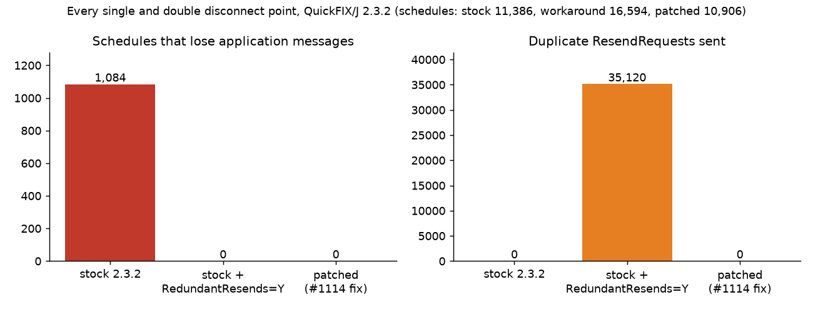

# FIX Session Recovery Checker

Finds every disconnect point at which a QuickFIX/J FIX session silently loses or duplicates messages, and proves a one-line fix for the lost-ResendRequest bug ([quickfix-j/quickfixj#1114](https://github.com/quickfix-j/quickfixj/issues/1114)), for connectivity engineers and SDETs who run FIX order-entry sessions.

## Results

- **Stock QuickFIX/J 2.3.2 loses orders in 1,398 of 14,592 disconnect schedules**, including the single-disconnect #1114 case (a ResendRequest cut by a connection drop).
- **The fix loses and duplicates 0 messages across all 14,004 schedules** of the patched build, checked against a FIX gap-fill reference model.
- **The `SendRedundantResendRequests=Y` workaround sends 35,120 duplicate ResendRequests; the fix sends 0** in the same congested-burst runs.
- **60 sampled schedules over real loopback TCP give the same outcome as the in-JVM runs**, including mid-frame cuts made by a FIX-aware NIO proxy.



**Stack:** Java 21, QuickFIX/J 2.3.2, FIX 4.4, JUnit 5 (+ JUnit 4 for the upstream test), Maven multi-module, Java NIO sockets (TCP proxy), Python + matplotlib (figure)

## Quickstart

```bash
mvn -B verify                                                          # 35 tests: reproducer, sweeps, real-TCP confirmations
bash scripts/explore.sh --max-app-messages 4 --disconnects 2 --check   # full sweep -> results/schedules.csv, results/summary.md
java -cp "harness/target/classes:$(mvn -q -pl harness dependency:build-classpath -Dmdep.outputFile=/dev/stdout)" fixresend.Debug 2 N MEMORY 15:BEFORE
```

The last command replays one schedule (2 orders per side, in-memory store, connection cut before send #15, a ResendRequest) against stock QuickFIX/J and prints the engine log: `Already sent ResendRequest FROM: 7 TO: 7. Not sending another.`, then `LOST@A(I-2 seq 7)`.

## Motivation

`Session.sendResendRequest` in QuickFIX/J ignores the return value of `sendRaw`. If the connection drops just before the write (the I/O thread has already run `disconnect()`, which clears the responder and resets the resend range), the request never goes out, but the range is recorded as requested anyway. After the next Logon the engine sees the gap again, logs "Already sent ResendRequest ... Not sending another", and the missing messages are never asked for. The session stays logged on and the orders are gone. The bug was reported against 2.1.1 ([#1114](https://github.com/quickfix-j/quickfixj/issues/1114)) and the code is unchanged in 2.3.2. The only workaround in the issue, `SendRedundantResendRequests=Y`, re-requests on every out-of-sequence message. Related open issues in the [tracker](https://github.com/quickfix-j/quickfixj/issues): #1243 (messages from a dead connection processed on the new one), #888 (resend range not reset when a ResendRequest is rejected).

## How it works

```
harness/        fault shim, scenario driver, explorer, reference model, TCP proxy (main code)
run-stock/      tests against unmodified quickfixj-core 2.3.2
run-patched/    the same tests with a patched quickfix.Session first on the classpath
patches/        quickfixj-1114.patch: the fix plus a JUnit regression test, for upstream
scripts/        explore.sh (CLI sweep), plot_results.py (figure), make-patch.sh
results/        schedules.csv (every schedule and its outcome), summary.md
```

- **Two real QuickFIX/J sessions in one JVM** (`Scenario`): an initiator and an acceptor built by `DefaultSessionFactory`, with memory or file message stores. A `SimClock` is installed as QuickFIX/J's `SystemTimeSource`, so heartbeats, TestRequests, logon timeouts and reconnect delays run on simulated time, single-threaded, and every run is deterministic. The acceptor binds its connection on the first Logon and takes HeartBtInt from it, as `AcceptorIoHandler` does.
- **Script**: Logon, application messages (generic numbered `NewOrderSingle`s) in both directions, a Heartbeat exchange, a stalled initiator that makes the acceptor send a TestRequest, a planned Logout, orders entered while logged out, re-Logon with gap recovery (ResendRequest, resend, SequenceReset-GapFill), more orders, then up to 240 simulated seconds to settle.
- **Fault shim** (`Scenario.Shim`, a `quickfix.Responder`): numbers every outbound send of both sides (Logon, ResendRequest, SequenceReset-GapFill, Heartbeat, TestRequest, Logout, application) and cuts the connection at the scheduled sends. `BEFORE`: the drop is processed first, `send` returns false and the session disconnects (the #1114 race). `AFTER`: the frame is delivered, then the connection drops. In-flight frames and end-of-stream are delivered in TCP order.
- **Explorer**: runs the fault-free script, then every single disconnect point × {BEFORE, AFTER}, then every second point after it. Because runs are deterministic, a second fault is only tried at sends that exist in the first fault's run; later indices would never fire and are the same schedule. It sweeps 1..N orders per side, both stores, and three builds: stock, stock + `SendRedundantResendRequests=Y`, and patched. A congested-burst variant (the acceptor streams 5 orders while the initiator's ResendRequest is unanswered) measures redundant ResendRequests.
- **Reference model** (`ReferenceModel`): after settling, each side's application must have received every order the other side sent exactly once and in MsgSeqNum order. SequenceReset-GapFill may only skip admin sequence numbers, and both sessions must be logged on with each expecting the other's next sequence number. Violations: `LOST`, `DUPLICATED`, `OUT_OF_ORDER`, `APP_GAP_FILLED`, `NOT_RECOVERED`. `summary.md` lists the shortest schedule for each violation.
- **Real-TCP mode** (`TcpTransport`, `FixProxy`): the initiator socket connects to a Java NIO proxy on loopback (port 20000-29999), which connects to the acceptor's listener. The proxy parses FIX framing (BodyLength) and cuts the connection before, in the middle of (half the bytes) or after the chosen frame. The bytes the peer receives are read back from its socket. `TcpConfirm` replays sampled schedules this way and requires the same violations and send count as the in-JVM run.

## The fix

[`patches/quickfixj-1114.patch`](patches/quickfixj-1114.patch) (applies with `patch -p1` to the 2.3.2 sources):

```java
if (!sendRaw(resendRequest, 0)) {
    getLog().onErrorEvent("Failed to send ResendRequest ...; resend range not recorded");
    return;
}
```

It also adds `SessionResendRequestNotSentTest` (JUnit 4, the framework quickfixj-core uses). The test drops the connection while a ResendRequest is written, reconnects, and asserts that the next Logon triggers a new ResendRequest for the gap. It passes on the patched build and fails on stock 2.3.2; `run-stock` runs it through `JUnitCore` and asserts that failure. `run-patched` ships the patched `quickfix/Session.java` in its own `target/classes`, which Maven puts ahead of the quickfixj-core jar.

## Full results

From `bash scripts/explore.sh --max-app-messages 5 --disconnects 2 --check` (memory and file stores, 1-5 orders per side plus the burst variant; see [results/summary.md](results/summary.md)):

| Build | Schedules | Losing messages | Duplicating | Not recovered | Lost messages | ResendRequests sent | Duplicate ResendRequests |
|---|---:|---:|---:|---:|---:|---:|---:|
| stock 2.3.2 | 14,592 | 1,398 | 0 | 1,484 | 2,400 | 55,538 | 0 |
| stock + SendRedundantResendRequests=Y | 19,692 | 0 | 0 | 0 | 0 | 112,218 | 35,120 |
| patched (#1114 fix) | 14,004 | 0 | 0 | 12 | 0 | 56,242 | 0 |

Schedule counts differ by build because each build sends a different number of messages, and so has a different number of disconnect points. In stock, 1,378 of the 1,398 losing schedules end with a BEFORE cut at a ResendRequest or a Logon response; `results/summary.md` breaks them down by faulted message. A Logon cut loses messages through the same path: `nextLogon` continues into `doTargetTooHigh`, and the ResendRequest goes to a session that has already disconnected. All of them recover with the fix.

Shortest reproducers: `15:BEFORE` with 2 orders per side (single cut at the acceptor's ResendRequest) and `14:BEFORE` (cut at the acceptor's Logon response). Both lose order `I-2`.

## Running the tests

```bash
mvn -B verify          # ~25 s
```

| Module | Tests |
|---|---|
| harness | reference-model unit tests (7), FIX framing (3), schedules (3), scenario determinism, coverage and explorer pruning (3), proxy relays and mid-frame cut (2) |
| run-stock | #1114 reproducer with memory and file stores, upstream test fails on stock, workaround recovers, sweep of 4,810 schedules finds losses incl. the single ResendRequest cut, workaround burst floods, 30+1 real-TCP confirmations |
| run-patched | patched Session on classpath, reproducer recovers (2 stores), sweep of 10,310 schedules with 0 lost/duplicated/out-of-order/gap-filled, burst sends 0 duplicate ResendRequests, 30+1 real-TCP confirmations, upstream regression test passes |

## Using it with your own QuickFIX/J version and settings

- **Version**: set `quickfixj.version` in the root `pom.xml`. For a patched build, replace `run-patched/src/main/java/quickfix/Session.java` with your version's `Session.java` plus the fix (`scripts/make-patch.sh` regenerates the patch).
- **Settings**: session settings are in `Scenario.createSessions()` (HeartBtInt, ReconnectInterval, LogonTimeout, `SendRedundantResendRequests`, store type), and `Config` selects the store, redundant-resend flag, order count and burst size. To add a setting dimension (for example `ResetOnLogon` or `PersistMessages`), add a field to `Config` and set it in `createSessions()`.
- **Replay a schedule**: `fixresend.Debug <orders> <Y|N> <MEMORY|FILE> [burst=N] <send#:BEFORE|AFTER ...>` prints the engine log, every outbound send and the violations.

## Design notes

- Fault points are counted per outbound send, not per wall-clock instant, which keeps the space finite and exhaustive. Deterministic single-threaded execution makes every schedule a reproducible test case, and lets the explorer prune second faults soundly.
- The BEFORE cut runs `Session.disconnect` inside `Responder.send` and then returns false. This is the interleaving behind #1114: the I/O thread's disconnect wins the race against the session thread's write.
- Writes on a connection the peer has already closed succeed and are discarded, as a local TCP write does before the reset arrives.
- The real-TCP mode keeps the deterministic driver and moves only the bytes through sockets and the proxy. A mid-frame cut must behave like BEFORE, because the peer discards the partial frame.

## Limitations and next steps

- **Residual finding in the patched build (not fixed)**: 12 of 14,004 patched schedules lose no orders, but the session never resynchronises (`NOT_RECOVERED`). The minimal case is `14:BEFORE 15:AFTER`. When the acceptor's Logon response fails, `nextLogon` keeps running after the disconnect has cleared the queue. It re-enqueues the stale Logon, which is later processed on a new connection, and the session then waits forever for a gap that has already been filled. This is the same family as #1243. Per scope it is documented here and not patched; a guard in `nextLogon`/`enqueueMessage` for a session that has lost its responder would be the next fix to try.
- The fix stops the range from being recorded when the write fails *synchronously*. A write accepted by MINA and lost later in the socket buffer is not covered. That case is fixed by the next Logon's sequence check, which the AFTER cuts exercise.
- Only FIX.4.4, one session pair, at most two disconnects per run, and up to 5 orders per side (plus a 5-order burst). Settings not swept: `ResetOnLogon`, `PersistMessages=N`, chunked resends (`ResendRequestChunkSize`), `EnableNextExpectedMsgSeqNum`.
- File-store runs reuse one session object across reconnects. They test the store as written, but not a process restart that reloads it. Adding a "restart" fault that rebuilds the sessions from the file store is the natural next step.
- Real-TCP confirmation runs a sample of 60 schedules plus two mid-frame cases, not the whole space. It uses the harness's own socket transport rather than QuickFIX/J's MINA `SocketInitiator`/`SocketAcceptor`.
- #888 and #621 are out of scope and not exercised.

Project period: 2026-08-08 to 2026-08-11.
